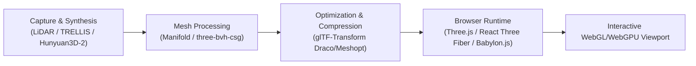

# Awesome 3D Mesh Generation & WebGL Tutorials

> A curated directory of the best **SaaS platforms**, **generative AI 3D engines**, and **open-source GitHub repositories** for 3D mesh generation, WebGL/WebGPU shaders, procedural geometry, LiDAR-to-Three.js pipelines, and browser-based 3D modeling.

**Last updated: November 2026**

---

## Table of Contents

- [Sector Overview & Market Dynamics](#sector-overview--market-dynamics)
- [SaaS & Hosted 3D Platforms](#saas--hosted-3d-platforms)
- [Open-Source GitHub Projects](#open-source-github-projects)
- [Key Architectural Stacks & Workflows](#key-architectural-stacks--workflows)
- [How to Contribute](#how-to-contribute)
- [Disclaimer & License](#disclaimer--license)

---

## Sector Overview & Market Dynamics

The global 3D modeling and browser graphics software market represents an estimated **$12B to $14B** industry in 2026 (expanding toward $25B by 2032 at a 7–14% CAGR across CAD, web visualization, and generative 3D subsectors). 

The sector is **moderately fragmented**: legacy enterprise CAD and engineering workflows remain consolidated under a few multi-billion-dollar incumbents (Autodesk, PTC, Dassault Systèmes), while real-time web 3D, generative AI mesh synthesis, and interactive browser-based 3D design are highly fragmented and driven by dynamic SaaS upstarts and vibrant open-source communities.

---

## SaaS & Hosted 3D Platforms

Below is a breakdown of hosted web 3D design studios, cloud CAD systems, and interactive learning platforms, sorted by **Company Valuation / Revenue Scale (Descending)**.

| Platform | Valuation / Revenue Scale | Starting Pricing Tier | Free Tier Limits | Primary Focus & Highlights |
| :--- | :--- | :--- | :--- | :--- |
| **[Autodesk Tinkercad](https://tinkercad.com)** | Parent Autodesk Market Cap: **~$54B** (TTM Rev: ~$7.4B) | **$0** (Free for educational & hobby use) | **100% Free forever**; strictly non-commercial/educational terms of service, no direct team collaboration admin controls. | Browser-based CSG solid modeling, Codeblocks procedural scripting, and 3D printing export. |
| **[Sketchfab](https://sketchfab.com)** | Divested by Epic Games ($23B val) to KitBash SF (Parent Epic Rev: **~$5.6B**) | **$15/month** (Pro plan) | **Basic Plan (Free forever)**: Up to 100MB per upload, 10 free public uploads/month, public/unlisted visibility only; player retains Sketchfab branding. | Leading 3D model viewer, WebGL inspect tool (wireframe/topology), and embeddable portfolio showcase. |
| **[Onshape](https://onshape.com)** | Acquired by PTC for **$470M** (PTC Market Cap: **~$22B**) | **$125/month** ($1,500/year, Standard tier) | **Free Plan (Free forever)**: Strictly non-commercial and hobby use; capped at **10 private documents (100MB private storage)**, all other models are permanently public. | Cloud-native parametric 3D CAD, assembly modeling, and browser FeatureScript scripting. |
| **[Meshy 3D](https://meshy.ai)** | Valuation: **$1.5B** (ARR: **$100M+**, Series B) | **$20/month** (Pro plan) | **Free Plan (Free forever)**: **100 credits/month** (~3-5 generations), capped at **10 downloads/month** (Meshy 6 Lite only, untextured); requires CC-BY-4.0 attribution. | Generative AI 3D mesh modeling, text-to-3D, image-to-3D, and automatic PBR texturing. |
| **[Spline](https://spline.design)** | Valuation: **$50M–$100M** (ARR: **~$5M–$7M**) | **$12/month** ($144 billed annually for Hobby; $15/mo monthly) | **Free Plan (Free forever)**: Personal files capped, exports include **mandatory Spline watermark**; no AI credits or native AR/USDZ/STL exports. | Collaborative real-time 3D web design, interactive physics, React/Three.js code exports, and WebGPU viewports. |
| **[PlayCanvas](https://playcanvas.com)** | Subsidiary of Snap Inc. (Snap Market Cap: **~$17B**) | **$15/month** (Personal tier) | **Free Plan (Free forever)**: **1 GB asset storage limit**, unlimited public projects only (0 private projects), must retain PlayCanvas loader branding. | Cloud-hosted collaborative WebGL/WebGPU game and interactive 3D engine with browser-based code/scene editor. |
| **[Vectary](https://vectary.com)** | Estimated Valuation: **$25M–$40M** (ARR: **~$3M–$4M**) | **$12/month** (Starter / Pro tier) | **Free Plan (Free forever)**: Capped at **5 to 10 active projects**, 1 workspace seat, 3,000 monthly AI credits, and mandatory Vectary viewer watermark. | Browser-based parametric 3D modeling, web configurators, and instant AR/WebGL iframe embeds. |
| **[Three.js Journey](https://threejs-journey.com)** | Solo-founder Studio: **$4.5M–$5.1M** cumulative gross rev (51,000+ students) | **$95** (one-time payment, lifetime access) | **Free Chapters**: Full public access to first **3 complete chapters** (Introduction, WebGL foundations, and First Three.js Project) with no time expiry; remaining curriculum locked. | Gold-standard hands-on WebGL, GLSL shader, Blender-to-Three.js, and React Three Fiber interactive tutorial curriculum. |
| **[Blender Studio](https://studio.blender.org)** | Blender Foundation Annual Budget: **~$3.5M–$4.2M** | **€11.50/month** (Voluntary membership) | **Blender Core is 100% Free** (GPL license, no limits); Blender Studio offers a limited selection of free public sample tutorials, while production assets require membership. | Official open-movie production asset repository, procedural Geometry Nodes courses, and advanced Blender masterclasses. |
| **[Clara.io](https://clara.io)** *(Historical)* | Pivoted to Threekit ($65M Series B); Clara.io **retired Dec 31, 2022** | **Historical: $10/month** (Standard) | **Historical Free Tier**: 5GB cloud storage, public scenes only; service permanently shut down in 2022. | Historical reference: Early browser-based polygonal mesh modeler and WebGL cloud rendering suite. |

---

## Open-Source GitHub Projects

Curated open-source libraries, procedural mesh toolkits, CAD engines, and WebGL/WebGPU tutorials, sorted by **GitHub Stars (Descending)**.

| Repository | GitHub Stars | License | Description |
| :--- | :--- | :--- | :--- |
| **[Three.js](https://github.com/mrdoob/three.js)** |  | `MIT` | The ubiquitous JavaScript 3D library and procedural geometry engine powering modern WebGL and WebGPU in web browsers. |
| **[FreeCAD](https://github.com/FreeCAD/FreeCAD)** |  | `LGPL-2.0+` | Open-source parametric 3D CAD modeler built for product design, mechanical engineering, and mesh export. |
| **[React Three Fiber](https://github.com/pmndrs/react-three-fiber)** |  | `MIT` | Declarative, reactive Three.js wrapper component framework for React enabling high-performance 3D scene construction. |
| **[Babylon.js](https://github.com/BabylonJS/Babylon.js)** |  | `Apache-2.0` | Full-featured enterprise TypeScript WebGL/WebGPU 3D engine with live browser Playground and Node Material/Geometry Editors. |
| **[Blender](https://github.com/blender/blender)** |  | `GPL-2.0+` | Flagship open-source 3D creation suite featuring polygonal/subdivision modeling, Geometry Nodes procedural mesh generation, and web-ready glTF export. |
| **[Hunyuan3D-2](https://github.com/Tencent/Hunyuan3D-2)** |  | `Tencent Open Source` | High-resolution open-source generative 3D mesh and PBR texture foundation model with interactive web UI and Blender add-on. |
| **[TRELLIS](https://github.com/microsoft/TRELLIS)** |  | `MIT` | Large-scale foundation model synthesizing high-fidelity textured 3D meshes, 3D Gaussians, and radiance fields from text or single images. |
| **[LearnOpenGL](https://github.com/JoeyDeVries/LearnOpenGL)** |  | `CC-BY-NC-4.0` | Foundational graphics programming guide covering vertex buffers, custom shader pipelines, lighting models, and mesh math. |
| **[OpenSCAD](https://github.com/openscad/openscad)** |  | `GPL-2.0+` | Script-based parametric solid 3D CAD modeler generating deterministic CSG meshes (STL, 3MF, OFF) via declarative code. |
| **[Drei](https://github.com/pmndrs/drei)** |  | `MIT` | Growing collection of useful helpers, procedural shaders, camera controls, and mesh abstractions for React Three Fiber. |
| **[CadQuery](https://github.com/CadQuery/cadquery)** |  | `Apache-2.0` | Python parametric B-Rep 3D CAD modeling framework built on OpenCascade for programmatic mechanical and architectural mesh generation. |
| **[WebGL Fundamentals](https://github.com/gfxfundamentals/webgl-fundamentals)** |  | `BSD-3-Clause` | Interactive tutorial series teaching 3D math, vertex buffers, textures, lighting, and custom mesh rendering from first principles. |
| **[build123d](https://github.com/gumyr/build123d)** |  | `Apache-2.0` | Next-generation Python-based 1D, 2D, and 3D parametric CAD modeling framework designed as a modern alternative to CadQuery and OpenSCAD. |
| **[three-mesh-bvh](https://github.com/gkjohnson/three-mesh-bvh)** |  | `MIT` | Fast Bounding Volume Hierarchy (BVH) spatial indexing implementation for accelerating raycasting and collision detection in Three.js meshes. |
| **[JSCAD](https://github.com/jscad/OpenJSCAD.org)** |  | `MIT` | Browser and Node.js programmatic 3D CAD mesh modeling and CSG boolean toolkit with live WebGL viewport previews. |
| **[3d-model-anything](https://github.com/wesbos/3d-model-anything)** |  | `MIT` | End-to-end pipeline combining iPhone LiDAR + photo capture, a scan-to-threejs AI agent skill, and an interactive Three.js physics viewer. |
| **[Manifold](https://github.com/elalish/manifold)** |  | `Apache-2.0` | High-speed C++/WebAssembly geometry library guaranteeing watertight, robust manifold 3D boolean mesh operations in browsers and native apps. |
| **[glTF-Transform](https://github.com/donmccurdy/glTF-Transform)** |  | `MIT` | Command-line tool and JavaScript/TypeScript SDK for inspecting, optimizing, and compressing (Draco, Meshopt, KTX2) 3D meshes before web deployment. |
| **[WebGL2 Fundamentals](https://github.com/gfxfundamentals/webgl2-fundamentals)** |  | `BSD-3-Clause` | Hands-on WebGL2 guide covering Vertex Array Objects (VAOs), instanced mesh rendering, 3D textures, and modern GPU pipelines. |
| **[WebGPU Fundamentals](https://github.com/webgpu/webgpufundamentals)** |  | `BSD-3-Clause` | Interactive tutorial suite for next-generation browser 3D graphics, WGSL shaders, and compute shader mesh generation. |
| **[three-bvh-csg](https://github.com/gkjohnson/three-bvh-csg)** |  | `MIT` | Synchronous and asynchronous high-speed Constructive Solid Geometry (CSG) boolean operations for Three.js meshes powered by `three-mesh-bvh`. |
| **[jam3 WebGL Shader Intro](https://github.com/Experience-Monks/jam3-lesson-webgl-shader-intro)** |  | `MIT` | Interactive WebGL and GLSL shader lesson repository introducing custom vertex/fragment pipelines and procedural 3D mesh effects. |
| **[Real-Time 3D Graphics with WebGL 2](https://github.com/PacktPublishing/Real-Time-3D-Graphics-with-WebGL-2)** |  | `MIT` | Code repository and interactive examples for building WebGL 2 rendering pipelines, lighting models, and custom mesh loaders. |
| **[Raw WebGL Lectures](https://github.com/nickdesaulniers/RawWebGL)** |  | `MIT` | First-principles lectures on the WebGL pipeline, vertex transformations, and low-level GPU rendering without high-level abstractions. |
| **[awesome-3d-skills](https://github.com/zhuyansen/awesome-3d-skills)** |  | `MIT` | Curated index of 190+ open-source AI agent skills and MCP servers across Blender, Three.js, FreeCAD, OpenSCAD, and 3D mesh generation. |

---

## Key Architectural Stacks & Workflows

To build production-grade web 3D applications, combine these tools into modular pipelines:

1. **Procedural & CSG CAD Stacks**: Use **OpenSCAD**, **CadQuery**, or **build123d** in Python / C++ to generate deterministic parametric models, or run **Manifold** / **three-bvh-csg** directly inside the browser for real-time constructive solid geometry.
2. **Generative 3D AI Pipelines**: Leverage foundation models like **TRELLIS** or **Hunyuan3D-2** for single-image to textured mesh generation, refine topology in **Blender**, and export as GLB.
3. **Web Asset Optimization**: Run raw generated meshes through **glTF-Transform** with Draco geometry compression, Meshopt quantization, and KTX2 texture transcoding before loading into **Three.js** or **React Three Fiber**.

---

## How to Contribute

Contributions are welcome! To propose new SaaS platforms or open-source repositories:

1. **Fork the repository** to your GitHub account.
2. **Add your entry** under the appropriate table or section following the existing markdown schema.
3. **Verify licensing and metrics**: Ensure accurate pricing, free tier limits, company scale, repo URLs, and licenses.
4. **Submit a Pull Request** with a descriptive summary of your additions.

---

## Disclaimer & License

- This curated list is maintained for educational and developer reference purposes. Products and company trademarks belong to their respective owners.
- When deploying generated 3D meshes to client browsers, always benchmark memory consumption, draw calls, and triangle counts on mobile hardware.
- Content licensed under [CC0 1.0 Universal](LICENSE).
